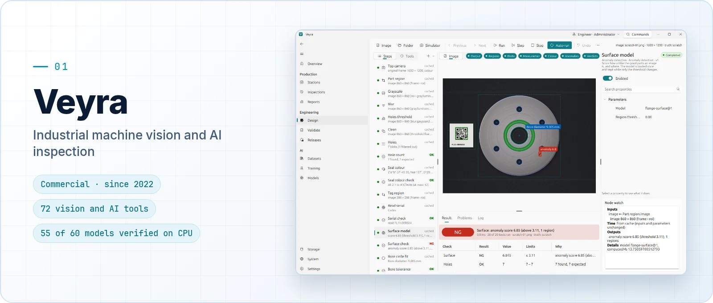
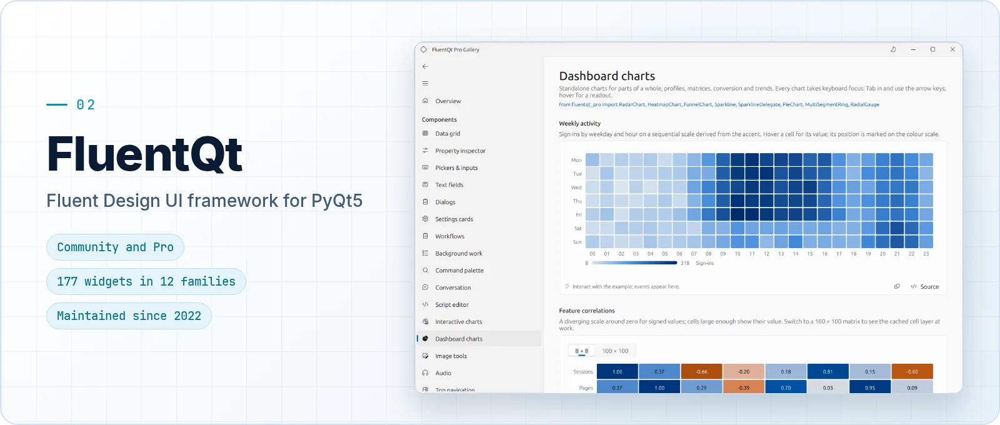
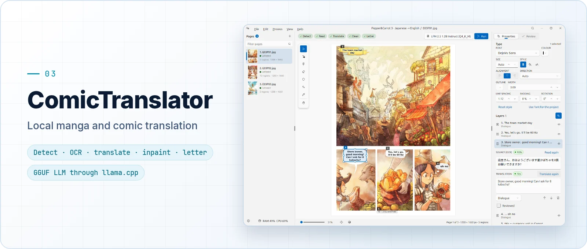
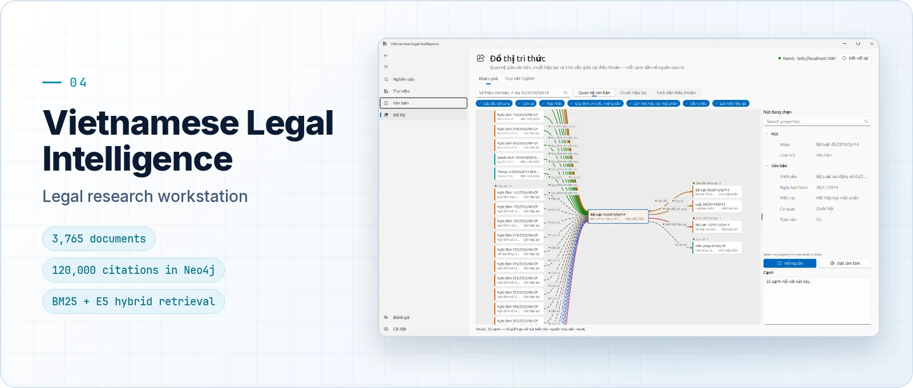
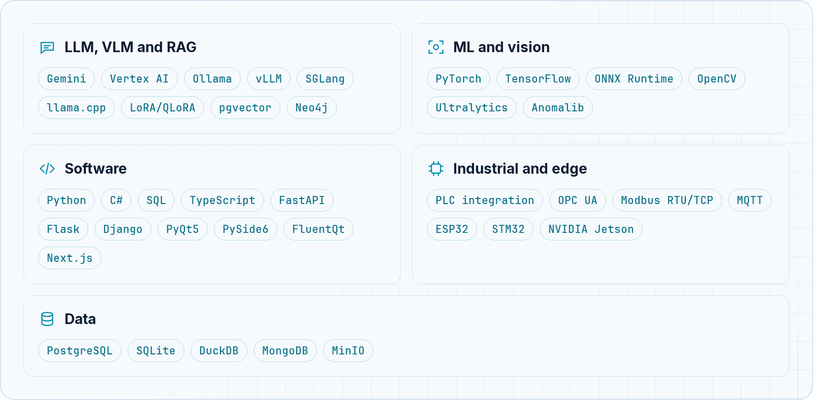

<picture>
  <source media="(max-width: 600px)" srcset="assets/hero-narrow.svg">
  
</picture>

I build AI systems end to end: data, models, evaluation, inference, and the software people use them through.
For more than five years I have taken computer vision, Document AI and LLM applications from proof of concept to
production, and I build independent desktop products on FluentQt, the Python UI framework I created.

- **LLMs, RAG and agents.** Agentic RAG, hybrid and graph retrieval, reranking, structured output, and local
  inference with Ollama, vLLM, SGLang and llama.cpp.
- **Document AI.** OCR, extraction with vision-language models, field localisation, validation and human review.
- **Computer vision and industrial AI.** Detection, segmentation, tracking and anomaly detection, connected to
  cameras, PLCs, Modbus, MQTT and edge devices.
- **Application engineering.** Python desktop software (PyQt5, FluentQt), FastAPI services, ONNX deployment and
  standalone builds.

### Featured projects

The source of these projects is private. Each card opens a public showcase with documentation and screenshots of the
real application.

<a href="https://github.com/pntrungbk15/veyra-showcase">
<picture>
  <source media="(max-width: 600px) and (prefers-color-scheme: dark)" srcset="assets/projects/veyra-dark-narrow.webp">
  <source media="(max-width: 600px)" srcset="assets/projects/veyra-light-narrow.webp">
  <source media="(prefers-color-scheme: dark)" srcset="assets/projects/veyra-dark.webp">
  
</picture>
</a>

**[Veyra](https://github.com/pntrungbk15/veyra-showcase)** is a commercial machine-vision and AI inspection platform,
developed since 2022. It has 72 vision and AI tools, camera and PLC stations, OK/NG evidence and labelling, and
Ultralytics and Anomalib training with parity-checked ONNX exports (55 of 60 models verified end to end on CPU).

<a href="https://github.com/pntrungbk15/fluentqt-showcase">
<picture>
  <source media="(max-width: 600px) and (prefers-color-scheme: dark)" srcset="assets/projects/fluentqt-dark-narrow.webp">
  <source media="(max-width: 600px)" srcset="assets/projects/fluentqt-light-narrow.webp">
  <source media="(prefers-color-scheme: dark)" srcset="assets/projects/fluentqt-dark.webp">
  
</picture>
</a>

**[FluentQt](https://github.com/pntrungbk15/fluentqt-showcase)** is a Fluent Design UI framework for PyQt5 in
Community and Pro editions, maintained since 2022. Community has 177 widgets in 12 families, theming, frameless
windows, six languages and SQLite persistence. Pro adds data grids, charts, a node editor and computer-vision UI.
Every application on this page is built on it.

<a href="https://github.com/pntrungbk15/comic-translator-showcase">
<picture>
  <source media="(max-width: 600px) and (prefers-color-scheme: dark)" srcset="assets/projects/comic-translator-dark-narrow.webp">
  <source media="(max-width: 600px)" srcset="assets/projects/comic-translator-light-narrow.webp">
  <source media="(prefers-color-scheme: dark)" srcset="assets/projects/comic-translator-dark.webp">
  
</picture>
</a>

**[ComicTranslator](https://github.com/pntrungbk15/comic-translator-showcase)** translates manga and comics locally.
It detects bubbles, runs multilingual OCR, translates with a GGUF LLM through llama.cpp, then inpaints and letters each
page for review. Pages shown: <i>Pepper&amp;Carrot</i> episode 3 by David Revoy, CC BY 4.0.

<a href="https://github.com/pntrungbk15/vietnamese-legal-intelligence-showcase">
<picture>
  <source media="(max-width: 600px) and (prefers-color-scheme: dark)" srcset="assets/projects/legal-intelligence-dark-narrow.webp">
  <source media="(max-width: 600px)" srcset="assets/projects/legal-intelligence-light-narrow.webp">
  <source media="(prefers-color-scheme: dark)" srcset="assets/projects/legal-intelligence-dark.webp">
  
</picture>
</a>

**[Vietnamese Legal Intelligence](https://github.com/pntrungbk15/vietnamese-legal-intelligence-showcase)** is a
legal research workstation. It parses 3,765 legal documents into more than 100,000 provisions and stores 120,000
citations in a Neo4j knowledge graph. Hybrid retrieval combines BM25, multilingual E5 and rank fusion. Answers come
from a local LLM, and each one is cited, checked against its sources, or declined.

**Also independent:**
[AI Annotation Workbench](https://github.com/pntrungbk15/annotation-workbench-showcase), computer-vision annotation
with 16 local ONNX models across 11 tasks ·
[Fluent Data Studio](https://github.com/pntrungbk15/fluent-data-studio), AI-assisted data analysis on DuckDB ·
[Audio Story](https://github.com/pntrungbk15/audio-story-showcase), an AI audio-storytelling studio ·
[ChessForge](https://github.com/pntrungbk15/chessforge-showcase), a chess workstation with a PyTorch self-play lab.

### Applied AI from industry work

Independent re-implementations of systems I built professionally. They use synthetic data only and contain no
production code or customer data.

| Project | What it does |
|---|---|
| **[SNY Septa Line Inspection](https://github.com/pntrungbk15/sny-septa-line-inspection)** | Surface inspection of a coated technical knit with seven cameras |
| **[DocFlow IDP](https://github.com/pntrungbk15/docflow-idp)** | Turns shipping-document PDFs into validated structured data, with a human-in-the-loop review workspace |
| **[Betty](https://github.com/pntrungbk15/betty-ai)** | An agentic RAG assistant that turns a conversation and a screenshot into a structured, estimated work ticket |
| **[ScanDoc AI](https://github.com/pntrungbk15/scandoc-ai)** | Document AI for scanned logistics documents: 88.9&nbsp;% field accuracy on held-out synthetic scans |
| **[WebIntel Logistics](https://github.com/pntrungbk15/webintel-logistics)** | Web crawling with layered structured extraction: 97.5&nbsp;% field accuracy on held-out synthetic sites |
| **[T-Shirt Quality Inspection](https://github.com/pntrungbk15/tshirt-quality-in)**, **[Date Code Inspector](https://github.com/pntrungbk15/mfg-exp-reading)** | Print and date-code inspection |

**Research implementations.** Results and write-ups of detection models I implemented:
[YOLO](https://github.com/pntrungbk15/YOLO) (v1 to v11 and YOLOX),
[RYOLO](https://github.com/pntrungbk15/RYOLO) (oriented detection),
[YOLO-Seg](https://github.com/pntrungbk15/YOLO-Seg) (instance segmentation),
[EAST](https://github.com/pntrungbk15/An-Efficient-and-Accurate-Scene-Text-Detector) and
[CRAFT](https://github.com/pntrungbk15/Character-Region-Awareness-for-Text-Detection) (scene-text detection).

### Stack

<picture>
  <source media="(max-width: 600px) and (prefers-color-scheme: dark)" srcset="assets/stack-dark-narrow.png">
  <source media="(max-width: 600px)" srcset="assets/stack-light-narrow.png">
  <source media="(prefers-color-scheme: dark)" srcset="assets/stack-dark.png">
  
</picture>

### Background

M.Sc. and B.Eng. in Electrical and Electronics Engineering (Automation), Ho Chi Minh City University of Technology.

<a href="mailto:pntrungbk15@gmail.com">pntrungbk15@gmail.com</a> · Ho Chi Minh City, Vietnam

